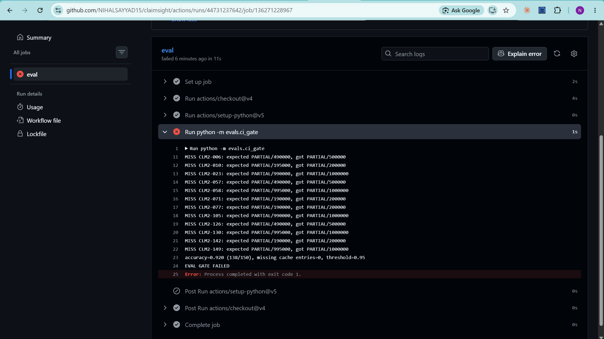

# claimsight
Multi-agent insurance claims analysis system with hybrid RAG, evals in CI, and Azure deployment

## CI eval gate
Every push re-runs the eval suite. A change that drops accuracy below 95% fails the build.

